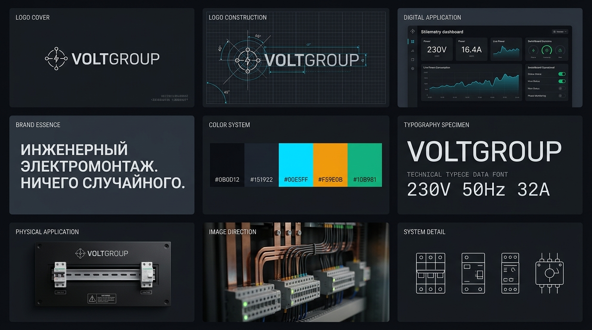

# Руководство по фирменному стилю VoltGroup (Brand Guidelines)

> **Версия:** 1.0  
> **Дата утверждения:** Ноябрь 2026  
> **Статус:** Официальный брендбук и дизайн-система  
> **Сфера:** Инженерный электромонтаж, сборка электрощитов, промышленная автоматизация и Умный дом

---

## 1. Философия и позиционирование бренда

### 1.1. Суть бренда (Brand Essence)
**«Инженерный электромонтаж. Ничего случайного.»**

VoltGroup — это инженерная компания высокой культуры монтажа. Мы не делаем «быстро на скрутках» и не продаем шаблонные решения. Каждый объект — это спроектированная силовая или слаботочная система с документированными расчетами нагрузок, защитой человека и оборудования, маркировкой каждого проводника и гарантией по договору.

### 1.2. Целевая аудитория
- **Владельцы квартир и загородных домов**, для которых безопасность семьи, надежность автоматики и эстетика скрытой инженерии важнее копеечной экономии.
- **Архитекторы и дизайнеры интерьеров**, ищущие надежного субподрядчика, умеющего читать сложные проекты ЭОМ и реализовывать трековое освещение, скрытые щиты и интеграцию с системами Умного дома без переделок.
- **Управляющие коммерческими и производственными объектами**, требующие соблюдения ПУЭ/ГОСТ, сборки щитов ВРУ/ГРЩ, шкафов автоматики и официальной отчетности.

### 1.3. Характер бренда (Brand Archetype)
- **Инженерная точность:** факты, формулы, номиналы, сечения кабелей.
- **Сдержанность:** отсутствие кричащего маркетинга, неоновых украшений и рекламного шума.
- **Открытость:** фиксированные сметы, онлайн-кабинет трекинга объекта, фотоотчеты каждого этапа.

---

## 2. Логотип и геометрия знака

### 2.1. Конструкция логотипа
Символ VoltGroup представляет собой **прецизионный векторный узел напряжения (Circuit Node)**, объединенный с динамическим импульсом проводимости:
- Центральный контур построен на балансе концентрических окружностей и узловых терминалов.
- Векторные лучи ориентированы строго под углами **45° и 90°**, символизируя геометрическую трассировку кабельных линий и шин в электрощите.
- Центральный вектор молнии выполнен в минималистичной геометрии без клипартовой агрессии.

### 2.2. Текстовая часть (Wordmark)
- Название набирается гарнитурой геометрического технического гротеска: **VOLTGROUP**.
- Пропорции букв выверены по оптической сетке. Прямой вертикальный штрих, умеренный трекинг (+2% на малых размерах, 0% на крупных вывесках).

### 2.3. Охранное поле
Минимальное свободное пространство вокруг логотипа равно **1.5 высоты литеры «O»**. Внутри охранного поля запрещается размещать посторонние графические элементы, края листа или плотный текст.

### 2.4. Правила недопустимого использования
- ❌ Запрещено искажать пропорции (растягивать по горизонтали или вертикали).
- ❌ Запрещено использовать радужные градиенты или дешевые неоновые эффекты свечения (`glow`).
- ❌ Запрещено добавлять тени с размытием (`drop-shadow`).
- ❌ Запрещено помещать логотип на визуально зашумленные, пестрые фотографии без подложки.

---

## 3. Цветовая система (Color System)

Палитра вдохновлена индустриальной эстетикой распределительных шкафов, медных шин и светодиодной индикации автоматики.

| Роль | Название | HEX | RGB | Назначение |
|---|---|---|---|---|
| **Base Ground** | Deep Charcoal | `#0B0D12` | `11, 13, 18` | Основной глубокий темный фон, консоли, корпуса |
| **Surface** | Industrial Slate | `#151922` | `21, 25, 34` | Поверхности карточек, панелей, пластронов, модулей |
| **Signal / Active** | Electric Cyan | `#00E5FF` | `0, 229, 255` | Главный акцент: фазное напряжение, ссылки, фокус |
| **Telemetry / Power**| DIN Amber | `#F59E0B` | `245, 158, 11` | Измерения мощности, предупреждения, нагрузки |
| **Safety / Ground** | Safety Green | `#10B981` | `16, 185, 129` | Защитный PE-проводник, норма, завершенные этапы |
| **Ink / Text** | Technical Chalk | `#F3F4F6` | `243, 244, 246` | Основной читаемый текст интерфейсов и документов |
| **Muted Ink** | Cable Ash | `#94A3B8` | `148, 163, 184` | Второстепенные подписи, единицы измерения, подсказки |

---

## 4. Типографика

Дизайн-система VoltGroup опирается на строгую двухшрифтовую иерархию:

### 4.1. Основной шрифт интерфейса и заголовков (Display & UI)
- **Гарнитура:** `Unbounded` (акцентные заголовки, вес 500–600) + `Inter` / `Manrope` (основной текст, вес 400–500).
- **Регистр:** исключительно **Sentence case** («Инженерный электромонтаж квартир»). Все кричащие капсы (`text-transform: uppercase`) запрещены.
- **Интерлиньяж:** 1.2–1.3 для заголовков; 1.55 для текстовых абзацев.

### 4.2. Технический моноширинный шрифт (Telemetry & Data)
- **Гарнитура:** `JetBrains Mono` / `Geist Mono` / `ui-monospace`.
- **Назначение:** вывод электротехнических параметров, номиналов, сумм, артикулов оборудования и таймстемпов.
- **Примеры оформления:**  
  `230V · 50Hz · 16.4A · 3.8 kW`  
  `Schneider Acti9 iC60N C16 1P 6kA`  
  `WirenBoard WB-MR6C v.2 Modbus RTU`

---

## 5. Иконографика и модульная система DIN

Вся графическая символика опирается на реальные электротехнические стандарты (IEC 60617 / ГОСТ 2.702):

1. **Однолинейные и схемные обозначения:**
   - 3-полюсный автоматический выключатель (MCB 3P).
   - Дифференциальный автомат / УЗО (RCD 2P / 4P) с кнопкой «Тест».
   - Реле напряжения с индикатором уставки (Welrok).
   - Программируемый релейный контроллер (Wirenboard / KNX).
2. **Геометрия и стиль иконок:**
   - Толщина линий: строго 1.5px или 2px.
   - Скругления стыков: `round`.
   - Запрет на использование детских эмодзи в интерфейсах — только векторные пиктограммы в едином цвете.

---

## 6. Физические носители и мерч

### 6.1. Маркировка электрощитов
- **Лицевой пластрон:** Матовый анодированный черный алюминий с лазерной гравировкой логотипа VoltGroup, серийного номера щита, даты сборки и QR-кода на исполнительную схему.
- **Модули DIN:** Печать маркировки термотрансферным принтером на невыцветающих полиэстеровых лентах (Brady / Brother).

### 6.2. Спецодежда инженеров
- Плотная рабочая ткань графитового цвета (`#151922`) со вставками световозвращающего канта.
- Вышитый шеврон с логотипом VoltGroup на левом рукаве и аккуратный логотип на спине.
- Никаких кислотно-оранжевых жилетов низкого качества — только профессиональный экип (Snickers Workwear / Dimex стиль).

### 6.3. Инструментальные кейсы и автотранспорт
- Брендирование системных кейсов (Systainer / L-BOXX / DeWalt ToughSystem): полимерные шильдики с лазерной гравировкой.
- Автомобиль сервиса: темный графит с лаконичной графикой трассировки цепей и телефонным номером без лишних рекламных лозунгов.

---

## 7. Тональность коммуникации (Voice & Tone)

| Избегаем (маркетинговый шум) | Используем (инженерная точность) |
|---|---|
| «Мы динамично развивающаяся команда лидеров рынка» | «Выполняем электромонтаж и автоматизацию в СПб с 2020 года» |
| «Сделаем всё по высшему разряду в кратчайшие сроки» | «Срок монтажа 2-комнатной квартиры — 4–6 рабочих дней» |
| «У нас самые низкие цены в городе!» | «Фиксированная стоимость в договоре до начала работ» |
| «Гарантия качества 100500%» | «Гарантия на монтажные работы 12 месяцев по акту приёмки» |

---

*Документ подготовлен с использованием скилла `brandkit` и интегрирован в дизайн-систему проекта VoltGroup.*
